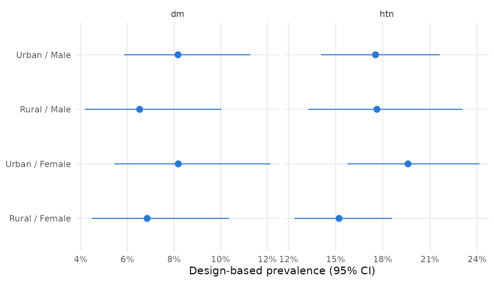

# A complete analysis with SurveyNCD

This vignette walks through a full analysis with **SurveyNCD** using the
two simulated datasets shipped with the package:

- `ncd_survey` holds 2,400 adults from a stratified two-stage cluster
  sample (12 strata, 120 primary sampling units, unequal weights).
- `child_anthro` holds 1,034 children under five from the same
  households.

**All data are synthetic and the regions are fictitious**, so no result
describes a real population. For a real-data example, see
[`vignette("real-data-nhanes")`](https://stataid-research-lab.github.io/SurveyNCD/articles/real-data-nhanes.md).

The workflow has four steps: build the design once, clean and score
respondents, then estimate and plot.

``` r

library(SurveyNCD)
library(survey)
#> Loading required package: grid
#> Loading required package: Matrix
#> Loading required package: survival
#> 
#> Attaching package: 'survey'
#> The following object is masked from 'package:graphics':
#> 
#>     dotchart
```

## 1. Clean raw answers and score respondents

STEPS-style questions are coded 1 = yes, 2 = no, 9 = don’t know; the
depression item is stored as text.
[`recode_binary()`](https://stataid-research-lab.github.io/SurveyNCD/reference/recode_binary.md)
maps both to 0/1 and leaves anything it cannot place as `NA`.

``` r

d <- ncd_survey
for (v in c("htn", "dm", "arth", "asthma", "angina", "stroke")) {
  d[[v]] <- suppressWarnings(recode_binary(d[[paste0(v, "_raw")]], yes = 1, no = 2))
}
d$dep <- suppressWarnings(recode_binary(d$dep_raw, yes = "Yes", no = "No"))
conds  <- c("htn", "dm", "arth", "asthma", "angina", "stroke", "dep")
labels <- c(htn = "Hypertension", dm = "Diabetes", arth = "Arthritis",
            asthma = "Asthma", angina = "Angina", stroke = "Stroke",
            dep = "Depression")

scored <- multimorbidity_index(d, conditions = conds, na_action = "na")
scored$age_group <- cut(scored$age, c(18, 30, 45, 60, 70), right = FALSE,
                        labels = c("18-29", "30-44", "45-59", "60-69"))
table(scored$mm_category, useNA = "ifany")
#> 
#>             None Single condition      Multimorbid             <NA> 
#>             1310              557              187              346
```

## 2. Build the survey design once

[`steps_design()`](https://stataid-research-lab.github.io/SurveyNCD/reference/design_helpers.md),
[`dhs_design()`](https://stataid-research-lab.github.io/SurveyNCD/reference/design_helpers.md)
and
[`mics_design()`](https://stataid-research-lab.github.io/SurveyNCD/reference/design_helpers.md)
use each programme’s standard variable names. Here the columns are
already named `psu` and `stratum`, so only the weight is needed. Every
estimation function below takes this design object.

``` r

des <- steps_design(scored, weight = "wt")
```

## 3. Prevalence

``` r

ncd_table(des, conds, by = "sex", labels = labels)
#> Design-based % (95% CI)
#>  Indicator    Overall          Female           Male            
#>  Unweighted n 2,400            1,234            1,166           
#>  Hypertension 17.0 (14.8-19.5) 16.5 (14.1-19.1) 17.6 (14.3-21.4)
#>  Diabetes     7.1 (5.6-9.1)    7.2 (5.3-9.8)    7.0 (5.2-9.5)   
#>  Arthritis    10.4 (9.0-12.0)  12.4 (10.1-15.1) 8.2 (6.5-10.4)  
#>  Asthma       3.9 (3.1-4.9)    3.6 (2.6-4.9)    4.2 (3.0-5.9)   
#>  Angina       3.1 (2.2-4.3)    2.7 (1.8-4.1)    3.5 (2.3-5.1)   
#>  Stroke       0.8 (0.5-1.3)    0.8 (0.4-1.7)    0.8 (0.5-1.4)   
#>  Depression   6.5 (5.2-8.1)    7.3 (5.5-9.8)    5.6 (4.2-7.3)
```

[`survey_prevalence()`](https://stataid-research-lab.github.io/SurveyNCD/reference/survey_prevalence.md)
returns the numbers behind the table and accepts several grouping
variables:

``` r

prev <- survey_prevalence(des, c("htn", "dm"), by = c("residence", "sex"))
prev
#>   indicator residence    sex   n   estimate         se      lower     upper
#> 1       htn     Rural Female 615 0.15215544 0.01552199 0.12357260 0.1859469
#> 2       htn     Rural   Male 542 0.17625922 0.02439366 0.13253373 0.2305762
#> 3       htn     Urban Female 571 0.19605364 0.02095188 0.15740668 0.2414700
#> 4       htn     Urban   Male 580 0.17535910 0.01878007 0.14082158 0.2162354
#> 5        dm     Rural Female 616 0.06847872 0.01437921 0.04469240 0.1035524
#> 6        dm     Rural   Male 549 0.06527557 0.01425549 0.04188441 0.1003616
#> 7        dm     Urban Female 578 0.08183294 0.01638334 0.05443064 0.1212614
#> 8        dm     Urban   Male 589 0.08170581 0.01332170 0.05867016 0.1127031
#>       deff
#> 1 1.146726
#> 2 2.217221
#> 3 1.587518
#> 4 1.412147
#> 5 1.993412
#> 6 1.825201
#> 7 2.061252
#> 8 1.390791
ggplot2::autoplot(prev)
```



Multimorbidity, overall and by two variables:

``` r

mm_prevalence(des)
#> 346 of 2400 rows have a missing multimorbidity score and are excluded from the survey-weighted estimate.
#>      n prevalence prevalence_se prevalence_lower prevalence_upper
#> 1 2054 0.09533923    0.01175125       0.07445529        0.1213131
#>   mean_conditions mean_conditions_se
#> 1       0.4850582         0.02954051
mm_prevalence(des, by = c("residence", "sex"))
#> 346 of 2400 rows have a missing multimorbidity score and are excluded from the survey-weighted estimate.
#>   residence    sex   n prevalence prevalence_se prevalence_lower
#> 1     Rural Female 547 0.09397847    0.01827722       0.06318866
#> 2     Rural   Male 491 0.09178940    0.01791648       0.06163755
#> 3     Urban Female 503 0.11153048    0.02256707       0.07365918
#> 4     Urban   Male 513 0.09042279    0.01819417       0.05997418
#>   prevalence_upper mean_conditions mean_conditions_se
#> 1        0.1375680       0.4938697         0.04533023
#> 2        0.1345756       0.4731381         0.04787520
#> 3        0.1653965       0.5154127         0.05939522
#> 4        0.1341244       0.4588677         0.04920903
```

### Age standardisation

Comparisons between groups or surveys with different age structures need
age-standardised estimates.
[`who_standard_population()`](https://stataid-research-lab.github.io/SurveyNCD/reference/who_standard_population.md)
re-aggregates the WHO World Standard Population to the STEPS age groups.

``` r

std <- who_standard_population(breaks = c(18, 30, 45, 60, 70))
std
#>   age_group lower upper    weight
#> 1     18-29    18    30 0.3075494
#> 2     30-44    30    45 0.3360723
#> 3     45-59    45    60 0.2512278
#> 4     60-69    60    70 0.1051505
mm_standardize(des, c("mm_multimorbid", "htn"), age_group = "age_group",
               standard = std, by = "residence")
#>        indicator residence    n     crude standardized         se      lower
#> 1 mm_multimorbid     Rural 1038 0.0929500    0.1271317 0.02377428 0.08053502
#> 2 mm_multimorbid     Urban 1016 0.1010242    0.1239801 0.02019656 0.08439560
#> 3            htn     Rural 1157 0.1634031    0.1962542 0.01838464 0.16022097
#> 4            htn     Urban 1151 0.1857694    0.2224265 0.01780756 0.18752427
#>       upper
#> 1 0.1737285
#> 2 0.1635647
#> 3 0.2322874
#> 4 0.2573286
```

### Which conditions occur together?

``` r

pairs <- mm_patterns(des, conds, top = 8)
pairs
#>     combination    n  prevalence          se       lower      upper    expected
#> 1      htn + dm 2242 0.029291564 0.005559247 0.020069601 0.04256694 0.012152568
#> 2    htn + arth 2271 0.028031444 0.004912569 0.019774392 0.03959706 0.017691381
#> 3  htn + asthma 2296 0.011243705 0.003596626 0.005952904 0.02113686 0.006636871
#> 4     htn + dep 2239 0.010807180 0.002412620 0.006936356 0.01680156 0.011025727
#> 5  htn + angina 2258 0.008862005 0.002119272 0.005511790 0.01421945 0.005246667
#> 6    arth + dep 2293 0.008237638 0.003105272 0.003894922 0.01733807 0.006742661
#> 7     dm + arth 2294 0.007982728 0.002086038 0.004751141 0.01338279 0.007431767
#> 8 arth + asthma 2350 0.006465750 0.001913627 0.003592820 0.01160920 0.004058704
#>    oe_ratio
#> 1 2.4103189
#> 2 1.5844690
#> 3 1.6941275
#> 4 0.9801784
#> 5 1.6890734
#> 6 1.2217192
#> 7 1.0741358
#> 8 1.5930576
ggplot2::autoplot(pairs)
```


An observed-to-expected ratio (`oe_ratio`) above 1 means a pair occurs
more often than if the two conditions were independent.

### How much could “don’t know” answers matter?

``` r

mm_bounds(des, conds)
#>                      scenario    n   estimate         se      lower     upper
#> 1               complete case 2054 0.09533923 0.01175125 0.07445529 0.1213131
#> 2  lower bound (missing = no) 2400 0.09437920 0.01024210 0.07594064 0.1167292
#> 3 upper bound (missing = yes) 2400 0.13346465 0.01260727 0.11039192 0.1604898
```

The lower and upper bounds treat every missing answer as “no” and as
“yes” respectively. Any assumption about the missing answers gives a
prevalence between them.

## 4. Socioeconomic inequality

``` r

survey_concentration_index(des, outcome = dm, wealth = wealth_score)
#> # A tibble: 1 × 8
#>   Concentration_Index Standard_Error Lower_CI Upper_CI      p_value Outcome_Mean
#>                 <dbl>          <dbl>    <dbl>    <dbl>        <dbl>        <dbl>
#> 1               0.314         0.0547    0.206    0.421 0.0000000100       0.0714
#> # ℹ 2 more variables: n <int>, Type <chr>
```

For a binary outcome the Erreygers- or Wagstaff-corrected index is
usually preferred:

``` r

survey_concentration_index(des, outcome = dm, wealth = wealth_score, type = "erreygers")
#> # A tibble: 1 × 8
#>   Concentration_Index Standard_Error Lower_CI Upper_CI      p_value Outcome_Mean
#>                 <dbl>          <dbl>    <dbl>    <dbl>        <dbl>        <dbl>
#> 1              0.0896         0.0156   0.0590    0.120 0.0000000100       0.0714
#> # ℹ 2 more variables: n <int>, Type <chr>
survey_concentration_index(des, outcome = dep, wealth = wealth_score, type = "erreygers",
                           by = "residence")
#> # A tibble: 2 × 9
#>   residence Concentration_Index Standard_Error Lower_CI Upper_CI p_value
#>   <chr>                   <dbl>          <dbl>    <dbl>    <dbl>   <dbl>
#> 1 Rural                 -0.0531         0.0196  -0.0914  -0.0148 0.00664
#> 2 Urban                 -0.0190         0.0189  -0.0560   0.0181 0.316  
#> # ℹ 3 more variables: Outcome_Mean <dbl>, n <int>, Type <chr>
```

Respondents tied on the ranking variable, such as wealth quintiles,
share a mid-rank, so the result does not depend on the order of the
rows.

Concentration curves and the slope and relative indices of inequality:

``` r

ggplot2::autoplot(survey_concentration_curve(des, dm, wealth_score, by = "residence"))
```


``` r

survey_slope_index(des, dm, wealth_score)
#>      n       SII  SII_lower SII_upper      RII RII_lower RII_upper
#> 1 2332 0.1344396 0.08845923   0.18042 7.419404  3.746373  14.69356
```

## 5. Child undernutrition from DHS-coded z-scores

``` r

ch <- child_anthro
ch$stunting <- who_anthro_score(ch$hw70, indicator = "stunting")
ch$stunted  <- as.numeric(ch$stunting %in% c("Severe stunting", "Moderate stunting"))
ch$stunted[is.na(ch$stunting)] <- NA
cdes <- steps_design(ch, weight = "wt")
survey_prevalence(cdes, "stunted", by = "wealth_quintile")
#>   indicator wealth_quintile   n   estimate         se      lower     upper
#> 1   stunted               1 208 0.45471539 0.03809082 0.38012071 0.5313995
#> 2   stunted               2 196 0.39582384 0.04221480 0.31542620 0.4822771
#> 3   stunted               3 201 0.33157688 0.03576747 0.26457055 0.4061808
#> 4   stunted               4 189 0.23226997 0.03970122 0.16259321 0.3203819
#> 5   stunted               5 221 0.09934761 0.02698571 0.05691678 0.1677826
#>       deff
#> 1 1.211290
#> 2 1.453110
#> 3 1.154438
#> 4 1.661744
#> 5 1.790506
survey_concentration_index(cdes, outcome = stunted, wealth = wealth_score, type = "wagstaff")
#> # A tibble: 1 × 8
#>   Concentration_Index Standard_Error Lower_CI Upper_CI  p_value Outcome_Mean
#>                 <dbl>          <dbl>    <dbl>    <dbl>    <dbl>        <dbl>
#> 1              -0.359         0.0457   -0.449   -0.270 3.91e-15        0.304
#> # ℹ 2 more variables: n <int>, Type <chr>
```

## 6. Experimental: mapping and machine learning

These functions are marked **experimental**. The map helper needs an
`sf` boundary file. The gradient-boosting functions use sampling weights
as case weights only, with no design-based uncertainty, so they are for
exploring patterns, not for inference.

``` r

reg <- mm_prevalence(des, by = "region")
#> 346 of 2400 rows have a missing multimorbidity score and are excluded from the survey-weighted estimate.
grid <- sf::st_make_grid(sf::st_as_sfc(sf::st_bbox(c(xmin = 0, ymin = 0, xmax = 3, ymax = 2))),
                         n = c(3, 2))
regions_sf <- sf::st_sf(region = paste("Region", LETTERS[c(4, 5, 6, 1, 2, 3)]),
                        geometry = grid)
survey_map_indicator(as.data.frame(reg), regions_sf, join_by = "region",
                     fill_var = "prevalence", palette = "cividis")
```


``` r

scored$female <- as.numeric(scored$sex == "Female")
scored$urban  <- as.numeric(scored$residence == "Urban")
des_ml <- steps_design(scored, weight = "wt")
fit <- survey_xgboost(des_ml, mm_n_conditions ~ age + bmi + wealth_score + female + urban,
                      params = list(objective = "reg:squarederror", max_depth = 3,
                                    eta = 0.05, nthread = 1),
                      nrounds = 150)
plot_shap_summary(survey_shap(fit), fit$X)
```


## How the example data were made

The datasets come from a known simulated population of 142,133 adults.
The code is in `data-raw/simulate_survey.R` in the [source
repository](https://github.com/StatAid-Research-Lab/SurveyNCD). Because
the population is known, estimates can be checked against the truth: for
example, the true multimorbidity prevalence is 9.5%.
