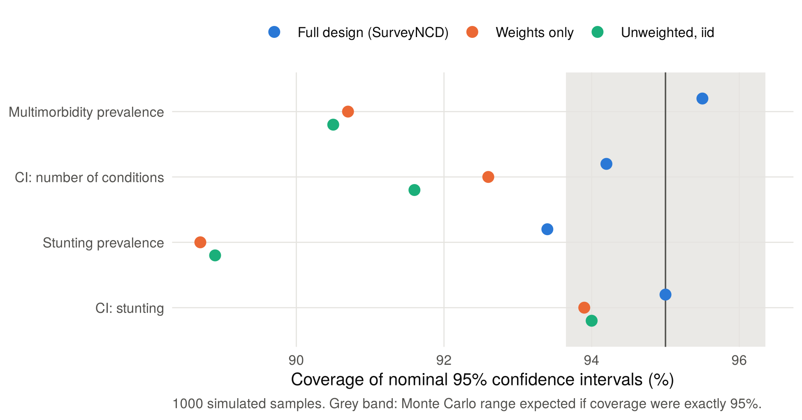

# Summary

Non-communicable diseases (NCDs) such as hypertension, diabetes and chronic respiratory disease are now the main cause of death worldwide. Much of what is known about them in low- and middle-income countries comes from household surveys: the WHO STEPwise approach to NCD risk-factor surveillance (STEPS) [@riley2016], the Demographic and Health Surveys (DHS) [@corsi2012] and the Multiple Indicator Cluster Surveys (MICS) [@khan2019]. These surveys do not select people at random. They stratify the country, sample clusters of households, and give each respondent a different sampling weight, so a simple average or an unweighted regression can give biased estimates and confidence intervals that are too narrow.

`SurveyNCD` is an R package that turns survey answers about whether a person has been told they have a chronic condition into population-level results that respect the survey design. It cleans inconsistent raw answer codes, counts each respondent's conditions, estimates the prevalence of multimorbidity (two or more conditions) with confidence intervals, measures how unequally a health outcome is spread across the wealth distribution, and classifies child growth measurements into WHO severity categories. It also provides a map helper and an explicitly exploratory machine-learning module. Two simulated datasets drawn from a known population ship with the package, so every function can be tried, and checked against the truth, immediately.

# Statement of need

Multimorbidity is a priority for the health systems where STEPS, DHS and MICS are run, and analysts routinely need design-based estimates of it. In practice each project re-implements the same steps by hand:

- recoding answer codes such as 1 = yes, 2 = no, 9 = don't know;
- summing conditions without silently treating missing answers as "no condition";
- building a `survey` design object;
- estimating subgroup (domain) prevalence without breaking the variance structure;
- computing a concentration index with a design-consistent standard error.

Each step is easy to get subtly wrong, and the errors (missing values counted as zeros, subgroups estimated by dropping rows, clustering ignored) are rarely visible in the output. `SurveyNCD` packages these steps as small, tested functions that return tidy data frames, so the choices that matter for validity are explicit arguments rather than ad hoc code. The intended users are epidemiologists, biostatisticians and graduate students analysing STEPS, DHS, MICS or similar microdata in R.

# State of the field

The `survey` package [@lumley2004] provides the variance estimators for complex designs and is the foundation of this work; `SurveyNCD` does not reimplement any of it. Comorbidity packages such as `comorbidity` [@gasparini2018] and `multimorbidity` [@multimorbidity] compute Charlson, Elixhauser and similar scores from ICD-coded diagnoses in clinical or claims data. They do not apply to self-reported survey answers. The Functional Comorbidity Index (FCI) [@groll2005] was designed for self-reported conditions; `SurveyNCD` provides its 18 conditions as a reference list and uses its unweighted-count scoring by default. A CRAN search for "functional comorbidity index" on 6 October 2026 returned no other package.

For health inequality, `rineq` [@rineq] provides concentration indices with decomposition, and `healthequal` [@healthequal] computes summary measures from subgroup-level estimates; @odonnell2008 is the standard methodological reference. For child growth, WHO's `anthro` [@anthro] computes z-scores and design-based prevalence from raw measurements. `SurveyNCD`'s `who_anthro_score()` is a smaller convenience for categorising DHS-coded z-scores. `SurveyNCD` claims no new estimator. It evaluates the convenient-regression concentration index of @kakwani1997 on respondent-level microdata inside a `survey` design object, so the standard error reflects strata, clusters and weights. This workflow contribution builds on `survey`, which deliberately stays domain-agnostic, rather than being added to it.

# Software design

\autoref{fig:workflow} shows how the ten exported functions fit together. Four decisions shape the package.

{width="100%"}

**A thin layer over `survey`.** All variance estimation uses `svydesign()`, `svyciprop()`, `svymean()` and `svyglm()`. Prevalence intervals use the logit method so they stay inside [0, 1]. Subgroup estimates apply `subset()` to the design object rather than filtering rows beforehand. Single-PSU strata are handled by setting `survey.lonely.psu = "adjust"` locally and restoring the user's option on exit.

**Missing answers are an explicit policy.** `recode_binary()` warns about any value it cannot place instead of guessing. `multimorbidity_index()` takes `na_action = "na"` (any missing condition gives a missing score) or `"ignore"` (sum the answered conditions). Under either policy a respondent with every condition missing is scored as missing, never as healthy, and `mm_prevalence()` reports how many respondents it excluded.

**Results do not depend on row order.** Respondents tied on the wealth variable, as with DHS wealth quintiles, share the mid-point of their group's cumulative-weight interval as their fractional rank. Version 0.1.0 ranked ties by row order: on the example data, 50 random orderings gave concentration indices from 0.011 to 0.029 around a correct value of 0.020. The current version always returns 0.020.

**Exploratory methods are fenced off.** `survey_xgboost()`, `survey_shap()` and `plot_shap_summary()` apply case weights to gradient boosting [@chen2016] and extract SHAP attributions [@lundberg2017]. They do not carry strata and clusters into uncertainty, are in `Suggests`, and are documented as exploratory.

**Validation.** With ties broken, `survey_concentration_index()` agrees with `rineq::ci()` to within $5 \times 10^{-16}$. Its design-based standard error is within 11% of a 500-replicate design bootstrap that recomputes the ranks in every replicate. To check frequency properties, we drew 1,000 samples with the shipped stratified two-stage design from the known population [@morris2019]. Full-design analyses had relative bias below 3%, standard-error ratios of 0.97–1.01 and 95% interval coverage of 93.4–95.5%. Ignoring clusters gave coverage of 88.7–93.9% (\autoref{fig:coverage}). Scripts reproducing every number run in about six minutes (`analysis/run_all.R`).

{width="90%"}

The package has a `testthat` suite (99 expectations), three vignettes, and continuous integration on five operating-system and R-version configurations. A minimal session:

```r
library(SurveyNCD); library(survey)
d <- ncd_survey
d$htn <- recode_binary(d$htn_raw, yes = 1, no = 2)
d$dm  <- recode_binary(d$dm_raw,  yes = 1, no = 2)
d$dep <- recode_binary(d$dep_raw, yes = "Yes", no = "No")
scored <- multimorbidity_index(d, c("htn", "dm", "dep"), na_action = "na")
mm_prevalence(scored, ids = "psu", strata = "stratum", weights = "wt")
des <- svydesign(ids = ~psu, strata = ~stratum, weights = ~wt,
                 data = scored, nest = TRUE)
survey_concentration_index(des, outcome = dm, wealth = wealth_score)
```

# Research impact statement

`SurveyNCD` 0.1.0 was released on CRAN on 28 September 2026. The project provides reproducible materials (simulated data with a known population, a simulation study and scripts for every reported number) and community-readiness signals (CRAN release, tests, CI, contribution guidelines, citation metadata). At the time of writing the software has not yet been used in a published or preprint analysis, and there is no external adoption to report.

[TODO, BLOCKING FOR JOSS: JOSS's pre-review screening requires evidence that the software is already used in research. Replace this bracket with specific, verifiable evidence once it exists: a manuscript, preprint or thesis that used `SurveyNCD` (with citation), the survey and wave analysed, and any external users, issues, pull requests or citations.]

# AI usage disclosure

Generative AI was used in this project, as follows.

- **Package code.** Claude Sonnet 5.5 (Anthropic) was used to help write the package's R code. [TODO, REQUIRED: state the nature of that assistance (for example generating functions, refactoring, debugging), and say whether the tests, vignettes, documentation and README were also AI-assisted.]
- **This paper and the October 2026 repository changes.** Claude (Anthropic; Sonnet 5.5 and Opus 5.5) was used to draft and edit this paper and to write the simulation, validation and figure scripts (`data-raw/`, `analysis/`). It was also used to prepare the tied-rank fix and its regression test, to add the example datasets, tests and the full-workflow vignette, and to draft `CONTRIBUTING.md`, `CITATION.cff` and README changes.

[TODO, REQUIRED, AUTHOR TO CONFIRM BEFORE SUBMISSION: JOSS asks authors to assert that the human authors reviewed, edited and validated all AI-assisted outputs and made the core design decisions. Add that sentence only if it is true, and make sure you can explain each design decision above in your own words.]

# Acknowledgements

The author thanks Professor Md. Atiqul Islam, Department of Statistics, Jagannath University, for academic mentorship and guidance. [TODO: add any funding, or state that no funding was received.]

# References
